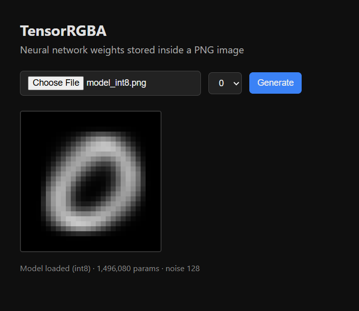
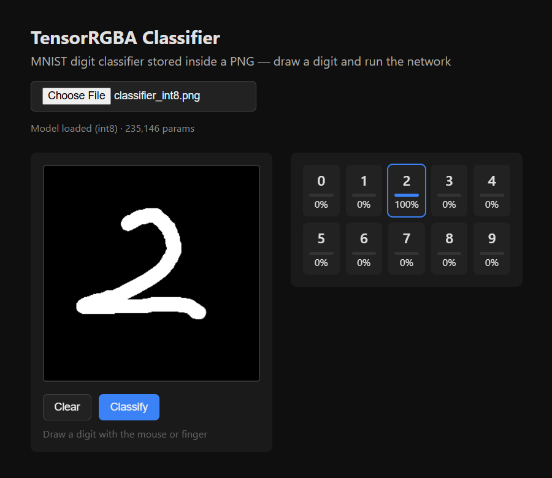
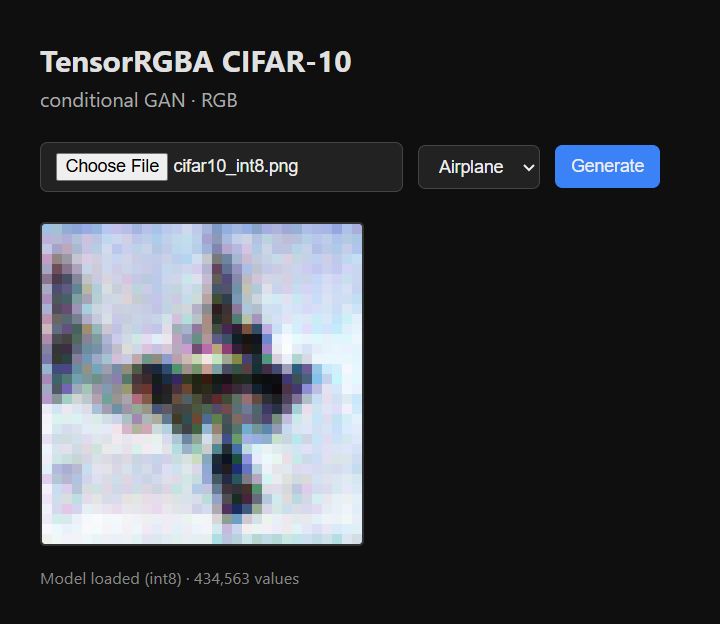
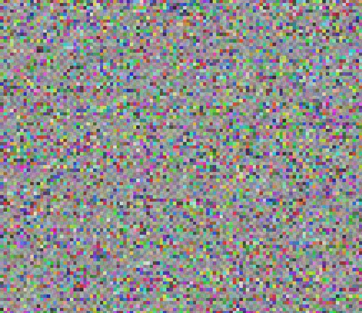

# TensorRGBA

Neural network weights stored inside a PNG image.

The trained model lives completely inside one lossless PNG file.
You load the image in the browser with a pure JavaScript PNG decoder and run inference with pure JavaScript. No backend. No heavy libraries.

**[Live demos](https://255jli.github.io/TensorRGBA/)** — models load automatically, no file picker required.

<p>
  
  
  
  
</p>

The last image is not a texture. It is the weight file. Change it to JPEG and the network stops working.

## What it does

- Packs neural network weights into a PNG in two formats:
  - **float32** — full precision (1 weight = 1 pixel)
  - **int8** — quantized (4 weights = 1 pixel)
- Runs inference entirely on the client with pure JavaScript

## Examples

| Example | Description | Location | Live |
|---------|-------------|----------|------|
| Digits | Handwritten digit generator (MNIST) | `examples/mnist/` | [demo](https://255jli.github.io/TensorRGBA/examples/mnist/web/) |
| CIFAR-10 | Conditional RGB generator for airplanes and ships | `examples/cifar10/` | [demo](https://255jli.github.io/TensorRGBA/examples/cifar10/web/) |
| Classifier | MNIST digit classifier — draw a digit and predict | `examples/classifier/` | [demo](https://255jli.github.io/TensorRGBA/examples/classifier/web/) |

## Project structure

```
examples/
  mnist/                - digit generator
  cifar10/              - airplane / ship RGB GAN
  classifier/           - digit classifier
docs/
  images/               - README screenshots
  integration.md        - how to pack your own model
  architecture.md
index.html              - live demo hub (GitHub Pages)
requirements.txt
```

## Quick start

```bash
python -m venv .venv
source .venv/bin/activate
pip install -r requirements.txt
```

### Digit generator

```bash
cd examples/mnist/train
python train.py
python export_float32.py --checkpoint checkpoints/generator_final.pt --output ../model_float32.png
```

Open `examples/mnist/web/index.html`.

### Classifier

```bash
cd examples/classifier/train
python train.py
python export_float32.py --checkpoint checkpoints/classifier_final.pt --output ../classifier_float32.png
```

Open `examples/classifier/web/index.html`, draw a digit, and classify.

### CIFAR-10 airplane / ship

```bash
cd examples/cifar10/train
python train.py
python export_float32.py --checkpoint checkpoints/airplane_ship_gan/airplane_ship_gan_final.pt --output ../cifar10_float32.png
```

Open `examples/cifar10/web/index.html`.

## Ready model files

Examples include exported PNG models. Demos auto-load the int8 variant when opened from the web or GitHub Pages.

## Cross-platform loading

The loader never uses Canvas or ImageBitmap for model data.
It fetches the file as an ArrayBuffer and decodes the PNG with a pure-JavaScript decoder. This avoids Windows color-profile and gamma issues.

## Extending

See `docs/integration.md` for a step-by-step guide on packing your own models.

## Notes

- Only PNG is supported. JPEG destroys the weights.
- The packed image looks like noise — that is expected.
- No post-processing is applied on the JavaScript side.

## License

MIT
